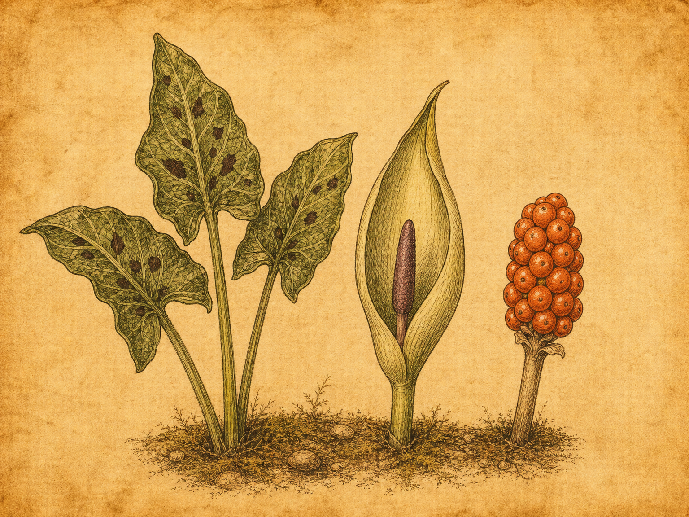
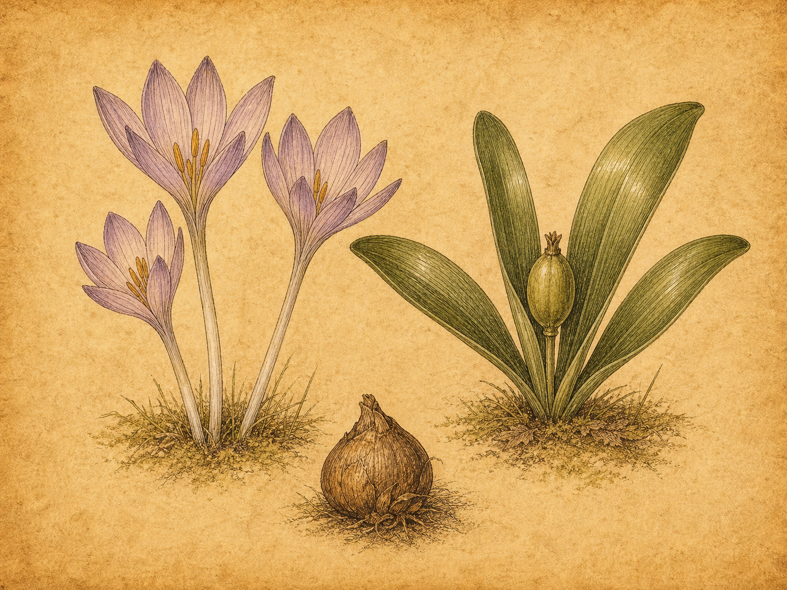
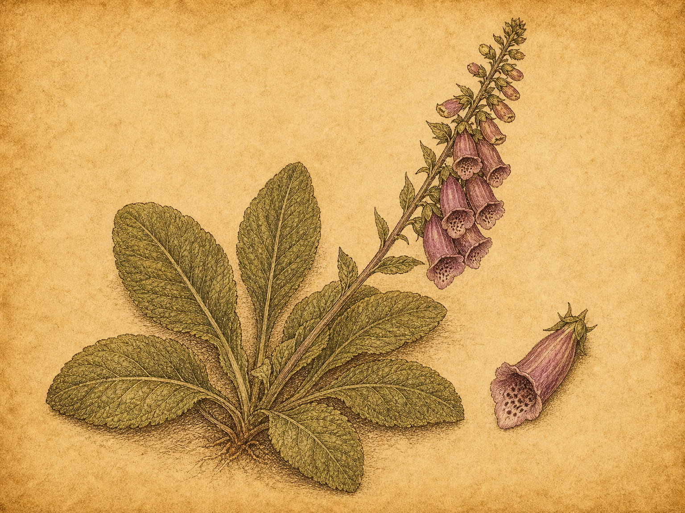
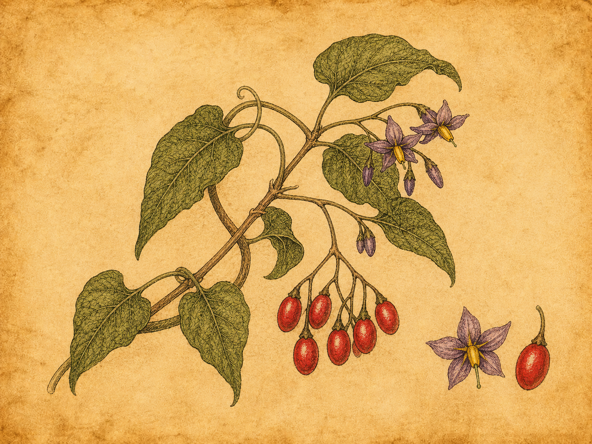
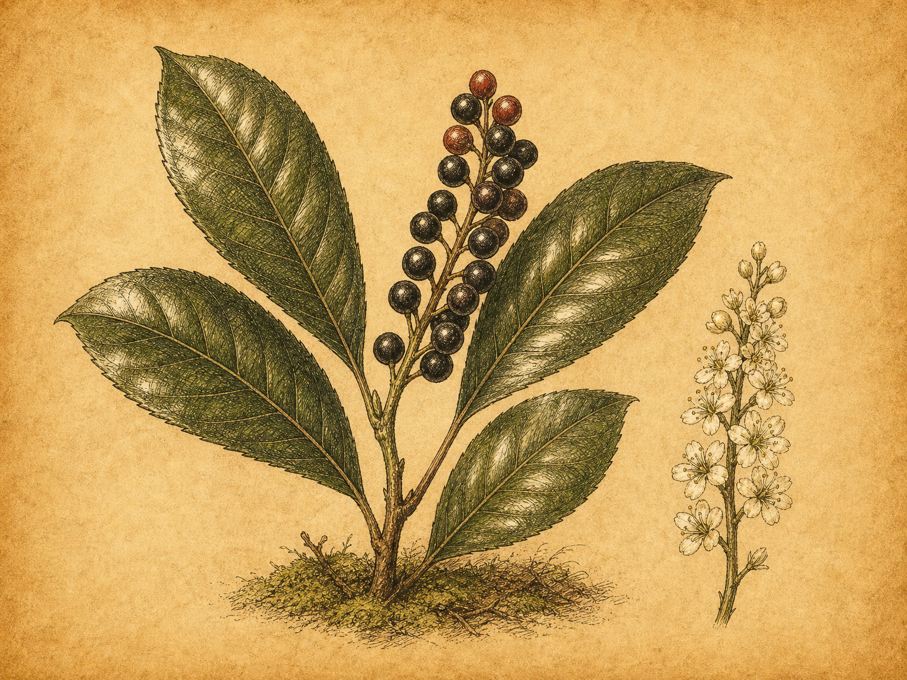
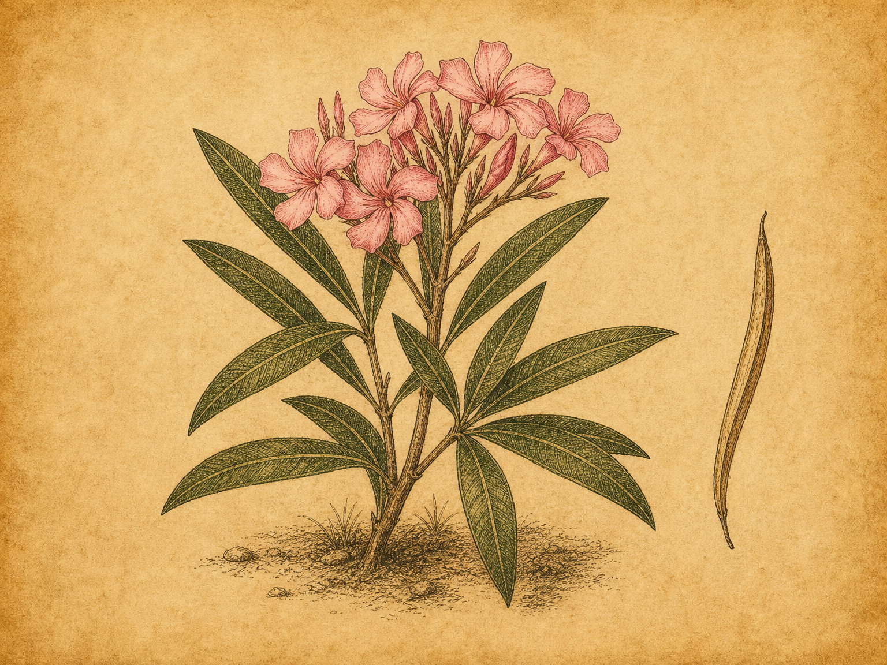
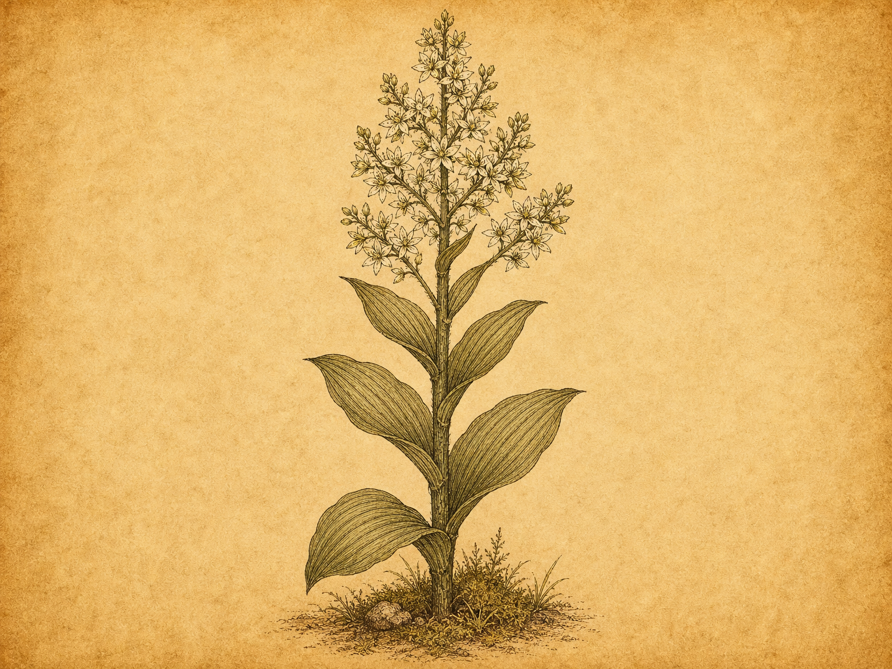

# Gravures à vérifier

Générées par l'API, pas encore dans l'appli.

### Aconit napel (`esp_aconit.png`)

### Arum tacheté (`esp_arum.png`)

### Belladone (`esp_belladone.png`)

### Berce du Caucase (`esp_berce.png`)

### Bryone dioïque (`esp_bryone.png`)

### Grande ciguë (`esp_cigue.png`)

### Colchique d'automne (`esp_colchique.png`)

### Datura stramoine (`esp_datura.png`)

### Digitale pourpre (`esp_digitale.png`)

### Douce-amère (`esp_douceamere.png`)

### Fusain d'Europe (`esp_fusain.png`)

### Houx (`esp_houx.png`)

### If (`esp_if.png`)

### Iris des marais (`esp_iris.png`)

### Laurier-cerise (`esp_laurier.png`)

### Laurier-rose (`esp_laurierrose.png`)

### Muguet (`esp_muguet.png`)

### Œnanthe safranée (`esp_oenanthe.png`)

### Ricin (`esp_ricin.png`)

### Vératre blanc (`esp_veratre.png`)

